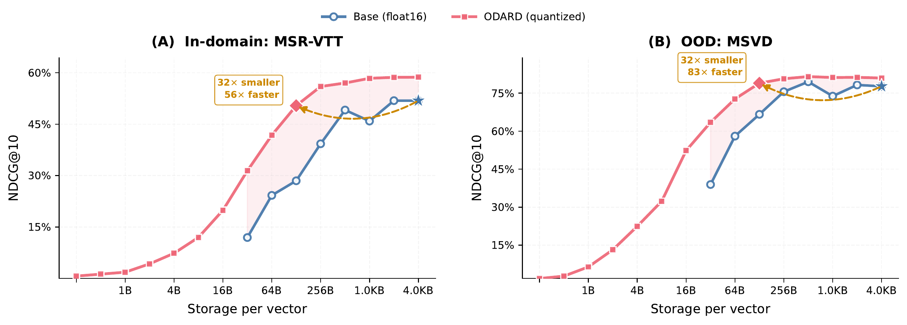
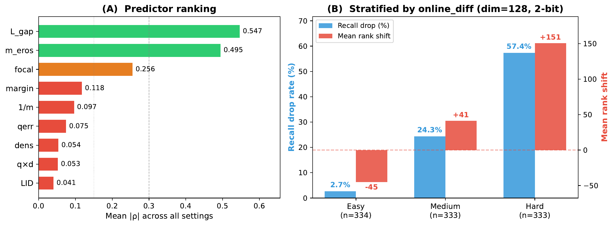

# IQD2RAD

**From Intrinsic Quantization Difficulty to
Ranking-Aware Distillation for Low-Bit Multimodal Retrieval**

**Accepted at TMLR.**

[Leiyue Chen](mailto:leiyue.ml@gmail.com) ·
[Hao Chen](mailto:haochen.umd@gmail.com)<sup>†</sup>

<sup>†</sup> Corresponding author.

[Paper](https://openreview.net/forum?id=4h8YJsubM1) *(coming soon)* ·
[Project Page](https://froyohunter.github.io/iqd2rad/)



**Storage–quality–speed trade-off.** ODARD (RAD with online difficulty weighting)
preserves retrieval quality with compact embeddings on MSR-VTT and MSVD.
Search speedups shown here use the paper's pinned FAISS 1.13.2 CPU setup;
see the paper for the full measurement protocol.

IQD measures how quantization changes retrieval rankings for individual samples.
RAD preserves ranking structure by distilling similarity distributions from the
float branch into low-bit branches. Online difficulty weighting provides an
optional, dataset-dependent extension.

This repository provides the Qwen3-VL-Embedding-2B reference training recipes,
an independent IQD analyzer, and data preparation and evaluation tools for the
paper's image and video settings.

The implementation quantizes **output embeddings**, not the backbone's model
weights. A trained adapter can be evaluated at several dimensions and bit widths.
The analyzer also accepts embeddings exported from other models.

## IQD analysis



**IQD is real but emergent.** Samples stratified by the online loss gap show
recall drops from 2.7% (easy) to 57.4% (hard), a 21.3× disparity
(Qwen3-VL, MSR-VTT, 128 dimensions, 2-bit).
Use the [independent IQD analyzer](docs/iqd.md) with your own embeddings,
or start with the [synthetic example below](#try-the-analyzer-without-a-model-or-dataset).

## Install

Use Python 3.11 or 3.12 in a separate environment:

```bash
python3.11 -m venv .venv
source .venv/bin/activate
python -m pip install -e '.[analysis,dev]'
```

The core analyzer/evaluator need only NumPy and SciPy; plots use the `analysis`
extra. For Qwen encoding and training, additionally install:

```bash
python -m pip install -e '.[train]'
# Optional public Weights & Biases logging:
python -m pip install -e '.[wandb]'
wandb login
```

The train extra pins compatible Torch/torchvision/Transformers versions.
See [training setup](docs/training.md) for CUDA, Flash Attention and SDPA options.
W&B logging is enabled by setting `wandb_project` in the training configuration.

## Try the analyzer without a model or dataset

```bash
python examples/make_toy_embeddings.py --output outputs/toy.npz
iqd2rad-iqd --embeddings outputs/toy.npz --output-dir outputs/toy-iqd \
  --dims 8,16 --bits 1,2,4,8 --k 5 --plots
iqd2rad-evaluate --embeddings outputs/toy.npz --output outputs/toy-eval.json \
  --dims 8 16 --backends float sign sq2 sq4 sq8
```

This is a synthetic smoke example, not a paper result.

## Encode and evaluate your prepared data

[Data preparation](docs/data.md) documents supported annotation formats and
explicit split/query selection. Supply your own raw images/videos or extracted
frames from the dataset providers, then prepare manifests with the supplied recipes:

```bash
iqd2rad-data prepare --config configs/data/msrvtt_train.json \
  --annotations /path/to/MSRVTT_train.7k.csv --raw-root /path/to/media
iqd2rad-data prepare --config configs/data/mscoco_1k.json \
  --annotations /path/to/mscoco_mmeb_test.jsonl --raw-root /path/to/images
```

A retrieval dataset consists of `queries.jsonl` and `candidates.jsonl`;
queries name their `positive_ids`. Gallery alignment is never inferred from row
position. Visual evaluation candidates must not contain caption text.
The encoding archive stores raw embeddings; each analysis/evaluation protocol
performs normalization at its own specified stage.

```bash
iqd2rad-encode \
  --queries /path/to/manifests/queries.jsonl \
  --candidates /path/to/manifests/candidates.jsonl \
  --data-root /path/to/raw-data \
  --base-model Qwen/Qwen3-VL-Embedding-2B \
  --revision BASE_MODEL_COMMIT \
  --output outputs/embeddings.npz

iqd2rad-evaluate --embeddings outputs/embeddings.npz \
  --dims 128 256 512 1024 2048 --backends float sign sq2 sq4 sq8 \
  --output outputs/retrieval.json
```

Use `--adapter /path/to/adapter` for a trained model. Set `--local-files-only`
explicitly for an offline installation. Keep the base-model revision alongside
every adapter and result.

## Three explicit quantization protocols

- **IQD measurement:** L2-normalize each vector, quantize on a fixed symmetric
  `[-1, 1]` grid (sign for 1 bit), then normalize for similarity computation.
- **Training:** the fixed symmetric grid with the straight-through estimator,
  using the main 2/4/8-bit branches.
- **Retrieval SQ:** fit per-channel affine ranges on the candidate index for each
  dimensionality, freeze them, and transform queries and candidates with the
  same ranges. Query vectors and relevance labels do not enter calibration.

These protocols are separate because they answer different experimental
questions. See [IQD analysis](docs/iqd.md) and [evaluation](docs/evaluation.md).

## Train the Qwen experiments

[Training](docs/training.md) documents the a–f configurations, manifest paths,
ordinary `torchrun` execution, attention backend and optional public W&B logging.
The two main recipes train on MSR-VTT and MSCOCO; the same manifest interface
supports the paper's Flickr30k and ActivityNet training data.
Separate image MSE/RAD configurations provide the optional 8-bit-only control;
the main recipes retain all three 2/4/8-bit training branches.

For example, launch the image RAD recipe on eight GPUs with SDPA:

```bash
torchrun --standalone --nproc_per_node=8 -m iqd2rad.training.cli \
  --config configs/qwen/image_e.json \
  --manifest data/prepared/mscoco_train/train.jsonl \
  --data-root /path/to/images --output-dir outputs/image-rad \
  --attn-implementation sdpa
```

The training guide records the reference settings, input convention, local
negative pool and multi-node launch instructions. Preparation recipes cover
MSR-VTT, MSCOCO (including Karpathy 5K), MSVD, DiDeMo, Flickr30k, ActivityNet
Captions and VisualNews. Keep split IDs, caption selection and frame policies
with your manifests when comparing settings.

## Development

Run the CPU algorithm and interface tests with:

```bash
python -m pytest -q
```

We welcome extensions to new backbones, datasets and quantization settings.
The manifest and embedding interfaces are intended to make those explorations
straightforward; please describe the setting alongside any results you share.

## Attribution

The Qwen model wrapper and preprocessing derive from
[Qwen3-VL-Embedding](https://github.com/QwenLM/Qwen3-VL-Embedding).
See [LICENSE](LICENSE) and [NOTICE](NOTICE) for the retained upstream attribution.

## Citation

If you use this implementation, please cite the accompanying paper.
BibTeX will be added once the final camera-ready citation metadata is available.
